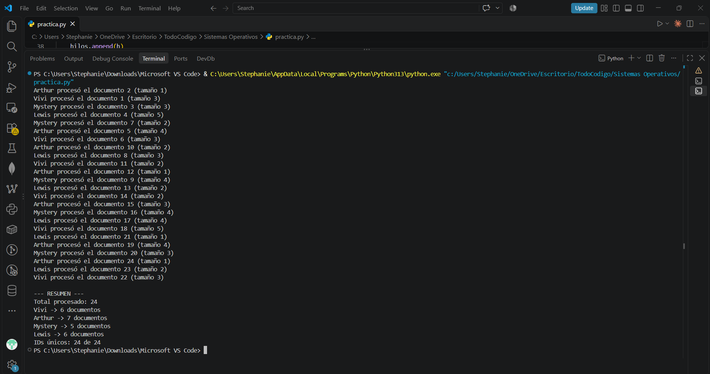
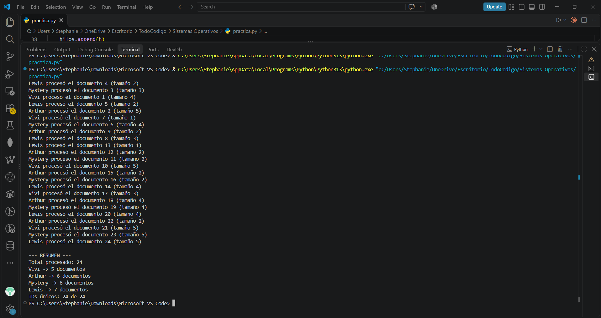
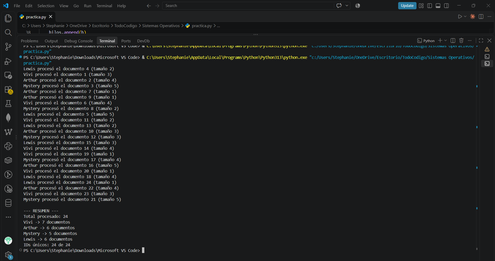

# SO_Practica-Lazarte
Stephanie Lazarte Rodas
# Práctica 1: Sistema de procesamiento de pedidos (Hilos y sincronización)

**Integrantes:** Lazarte Rodas Stephanie Leyda
**Materia:** Sistemas Operativos 
**Docente:** Ing. Genesis Danae Selaya Ticona

## Descripción
Cuatro hilos (trabajadores: Vivi, Arthur, Mystery y Lewis) sacan 24 documentos
de una cola compartida (queue.Queue). Cada documento se procesa una sola vez y
los resultados se guardan en un diccionario protegido con Lock.

## Interpretación por trabajador

Los cuatro trabajadores arrancan a la vez y cada uno saca un documento de la
cola apenas queda libre. Como cada documento tarda tamaño × 0.1 segundos, el
que tiene suerte con documentos chicos termina rápido y vuelve a la cola por
otro. Por eso el reparto no sale parejo. Tampoco salen en orden de ID: cada
línea se imprime cuando el trabajador termina, no cuando agarra el documento.
En las cuatro capturas los primeros documentos los tomaron igual (1 Vivi,
2 Arthur, 3 Mystery, 4 Lewis), porque los hilos se inician en ese orden. Desde
ahí ya depende de quién se desocupa primero.

### Captura 1
- Vivi: 6 documentos (1, 6, 11, 14, 18, 22)
- Arthur: 7 documentos (2, 5, 10, 12, 15, 19, 24)
- Mystery: 5 documentos (3, 7, 9, 16, 20)
- Lewis: 6 documentos (4, 8, 13, 17, 21, 23)

Arthur hizo más porque le tocaron varios de tamaño 1 (los docs 2, 12 y 24) y
volvía enseguida a la cola. Mystery hizo menos, pero con documentos medianos.

### Captura 2
- Vivi: 5 documentos (1, 7, 10, 17, 21)
- Arthur: 6 documentos (2, 9, 12, 15, 18, 22)
- Mystery: 6 documentos (3, 6, 11, 16, 19, 23)
- Lewis: 7 documentos (4, 5, 8, 13, 14, 20, 24)

Lewis fue el que más procesó porque empezó con documentos chicos (4, 5 y 13).
A Vivi le tocaron tres grandes (1, 10 y 21, de tamaño 4 y 5), así que terminó
con solo 5.

### Captura 3
- Vivi: 8 documentos (1, 5, 6, 11, 14, 15, 20, 23)
- Arthur: 4 documentos (2, 9, 16, 22)
- Mystery: 6 documentos (3, 8, 13, 18, 21, 24)
- Lewis: 6 documentos (4, 7, 10, 12, 17, 19)

Esta es la corrida más despareja. Vivi agarró tres documentos de tamaño 1 (1, 5
y 14) y siguió sacando. Arthur se quedó con tres de tamaño 5 (2, 9 y 22) y por
eso solo hizo 4.

### Captura 4
- Vivi: 7 documentos (1, 6, 11, 14, 19, 20, 23)
- Arthur: 6 documentos (2, 7, 9, 10, 16, 22)
- Mystery: 5 documentos (3, 8, 12, 17, 21)
- Lewis: 6 documentos (4, 5, 13, 15, 18, 24)

Aquí quedó más parejo. Mystery hizo 5 porque dos de sus documentos (3 y 21)
eran de tamaño 5. Vivi sacó dos de tamaño 1 seguidos (19 y 20).

### Qué se ve en las cuatro
Cada trabajador procesó entre 4 y 8 documentos según la corrida, pero la suma
de tamaños de cada uno quedó parecida (entre 16 y 21). O sea que la cola
reparte el trabajo de forma natural: el que termina primero toma más. En todas
el total fue 24 y los 24 IDs aparecieron una sola vez, sin repetirse ni
perderse, y los cuatro hilos terminaron sin quedarse bloqueados.

## Preguntas
**1. ¿Por qué queue.Queue es apropiada para compartir trabajos?**
Porque es segura para hilos, sus operaciones put y get ya están sincronizadas
internamente, así que dos trabajadores nunca sacan el mismo documento y no se
pierde ninguno, sin tener que bloquear la cola a mano.

**2. ¿Qué protege Lock y qué pasaría si se actualizara el resumen sin él?**
Lock protege el diccionario resultados, que usan los 4 trabajadores a la vez.
Cuando un trabajador suma 1 a su contador, la computadora lo hace en pasos:
primero lee el número, después le suma 1 y al final lo guarda. Con el Lock, un
solo hilo hace esos pasos a la vez y los demás esperan su turno.

Sin el Lock, dos hilos podrían leer el mismo número al mismo tiempo, sumar 1 y
guardar el mismo resultado, y una de las dos sumas se perdería. Eso se llama
condición de carrera. En el programa el resumen podría dar menos de 24
documentos aunque en realidad se hayan procesado los 24.                           

**3. ¿Qué cambiarías si cada documento tuviera que guardarse en un archivo real?**
Protegería la escritura (con Lock o con un hilo único que escriba), para que
dos trabajadores no mezclen o pisen el mismo archivo. Usaría un archivo por
documento (con su ID en el nombre) y manejaría errores de lectura y escritura.
Aquí los hilos sí ayudan más, porque esperar al disco es entrada/salida.

## Capturas

